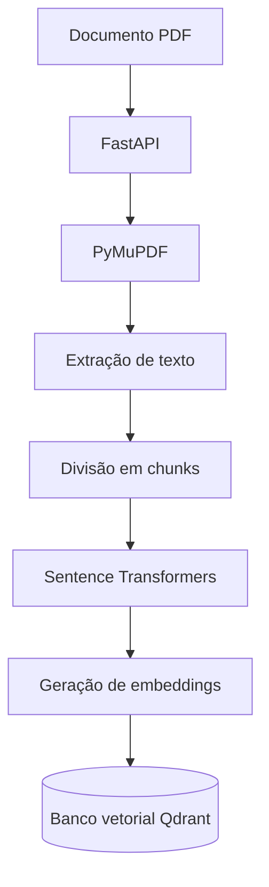
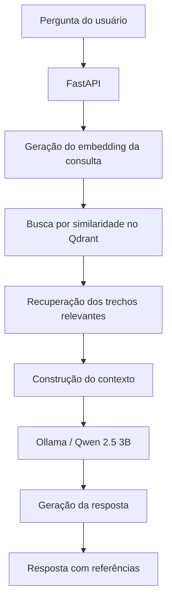

# Enterprise RAG Assistant

**Assistente inteligente para consulta de documentos utilizando RAG, modelos de linguagem e busca semântica.**

## Sobre o projeto

O Enterprise RAG Assistant é uma aplicação desenvolvida para permitir que usuários enviem documentos PDF e realizem perguntas sobre seu conteúdo, recebendo respostas contextualizadas com referências aos documentos e às páginas consultadas.

O projeto utiliza a arquitetura **Retrieval-Augmented Generation (RAG)**, combinando processamento de documentos, busca semântica em banco de dados vetorial e geração de respostas por meio de modelos de linguagem (LLMs).

A proposta é facilitar a consulta de informações em documentos, reduzindo a necessidade de pesquisas manuais e permitindo interações em linguagem natural.

## Funcionalidades

- Envio de documentos PDF por meio de uma API REST.
- Extração de texto utilizando PyMuPDF.
- Divisão do conteúdo em trechos menores (*chunking*).
- Geração de embeddings semânticos com Sentence Transformers.
- Armazenamento e busca vetorial utilizando Qdrant.
- Integração com modelos de linguagem executados localmente por meio do Ollama.
- Geração de respostas contextualizadas utilizando Qwen 2.5 3B.
- Apresentação de referências dos documentos e páginas consultadas.
- Documentação interativa da API com FastAPI e Swagger UI.

## Arquitetura da aplicação

A aplicação é organizada em dois fluxos principais: processamento e armazenamento de documentos e recuperação de informações para geração de respostas.

### 1. Processamento e armazenamento de documentos



### 2. Recuperação de informações e geração de respostas



## Tecnologias utilizadas

| Tecnologia | Aplicação no projeto |
|---|---|
| Python | Linguagem principal de desenvolvimento |
| FastAPI | Desenvolvimento da API REST |
| PyMuPDF | Extração de conteúdo de documentos PDF |
| Sentence Transformers | Geração de embeddings |
| multilingual-e5-small | Modelo de embeddings multilíngue |
| Qdrant | Armazenamento e recuperação vetorial |
| Ollama | Execução local de modelos de linguagem |
| Qwen 2.5 3B | Geração de respostas |
| Pydantic | Validação e estruturação de dados |
| Git e GitHub | Versionamento e documentação do projeto |

## Como funciona

### Processamento dos documentos

Os documentos PDF são processados utilizando PyMuPDF, responsável pela extração do conteúdo textual e identificação das páginas.

Após a extração, o texto é dividido em trechos menores (*chunks*), facilitando a recuperação de informações relevantes durante as consultas.

Cada trecho mantém metadados associados ao documento de origem, à página e à sua identificação.

### Geração de embeddings

O projeto utiliza o modelo `intfloat/multilingual-e5-small`, por meio da biblioteca Sentence Transformers.

Esse modelo transforma os textos em representações vetoriais de 384 dimensões, permitindo comparar semanticamente documentos e perguntas.

São utilizados os prefixos recomendados pelo modelo:

- `passage:` para os conteúdos dos documentos.
- `query:` para as perguntas dos usuários.

### Armazenamento e recuperação vetorial

Os embeddings e seus respectivos metadados são armazenados no Qdrant.

Quando uma pergunta é enviada, seu embedding é gerado e utilizado para realizar uma busca por similaridade vetorial, recuperando os trechos mais relevantes para a consulta.

### Geração de respostas

Os trechos recuperados são organizados em um contexto e enviados ao modelo Qwen 2.5 3B, executado localmente por meio do Ollama.

O modelo recebe instruções para elaborar respostas com base nas informações recuperadas, indicando os documentos e as páginas correspondentes.

## Estrutura do projeto

```text
enterprise-rag-assistant/
│
├── app/
│   ├── api/
│   │   └── routes.py
│   │
│   ├── schemas/
│   │   └── models.py
│   │
│   ├── services/
│   │   ├── document_loader.py
│   │   ├── chunking.py
│   │   ├── embeddings.py
│   │   ├── vector_store.py
│   │   ├── retriever.py
│   │   ├── llm.py
│   │   └── rag.py
│   │
│   └── main.py
│
├── documents/
├── tests/
├── evaluation/
├── .gitignore
├── requirements.txt
└── README.md
```

## Instalação e execução

### Pré-requisitos

- Python 3.12 ou compatível.
- Docker Desktop.
- Ollama.
- Git.

### 1. Clonar o repositório

```bash
git clone https://github.com/guilhermebaggi/enterprise-rag-assistant.git

cd enterprise-rag-assistant
```

### 2. Criar e ativar o ambiente virtual

No Windows PowerShell:

```powershell
python -m venv .venv

.\.venv\Scripts\Activate.ps1
```

### 3. Instalar as dependências

```bash
pip install -r requirements.txt
```

### 4. Executar o Qdrant

```powershell
docker run -d --name qdrant `
  --restart unless-stopped `
  -p 127.0.0.1:6333:6333 `
  -p 127.0.0.1:6334:6334 `
  -v qdrant_storage:/qdrant/storage `
  qdrant/qdrant
```

Painel de gerenciamento:

```text
http://localhost:6333/dashboard
```

### 5. Baixar o modelo de linguagem

```bash
ollama pull qwen2.5:3b
```

Certifique-se de que o Ollama esteja em execução.

### 6. Iniciar a aplicação

```bash
uvicorn app.main:app --reload
```

A aplicação estará disponível em:

```text
http://127.0.0.1:8000
```

Documentação interativa da API:

```text
http://127.0.0.1:8000/docs
```

## Endpoints da API

| Método | Endpoint | Descrição |
|---|---|---|
| GET | `/` | Verificação de funcionamento da aplicação |
| GET | `/health` | Verificação de disponibilidade |
| POST | `/documents/upload` | Envio e processamento de documentos PDF |
| POST | `/chat` | Envio de perguntas sobre os documentos indexados |

### Enviar documento

Endpoint:

```http
POST /documents/upload
```

Tipo de conteúdo: `multipart/form-data`

Parâmetro: `file` — arquivo PDF.

### Realizar uma pergunta

Endpoint:

```http
POST /chat
```

Exemplo de requisição:

```json
{
  "question": "Quais são os principais assuntos abordados neste documento?"
}
```

A resposta contém o texto gerado pelo modelo e as referências aos documentos e páginas recuperados.

## Limitações atuais

O projeto encontra-se em desenvolvimento e possui melhorias planejadas:

- Aprimoramento da extração de tabelas e da estrutura dos documentos PDF.
- Implementação de filtros para separar a recuperação de informações entre diferentes documentos.
- Melhorias nas estratégias de divisão de texto e relevância da recuperação.
- Redução de alucinações e aprimoramento da confiabilidade das respostas.
- Implementação de testes automatizados para avaliação da recuperação e geração.
- Containerização e aprimoramento do processo de implantação.

## Melhorias futuras

- Integração com Docker Compose.
- Filtros de recuperação por documento.
- Busca híbrida, combinando pesquisa semântica e textual.
- Implementação de técnicas de *reranking*.
- Suporte a OCR para documentos digitalizados.
- Avaliação automatizada de sistemas RAG.
- Melhorias no monitoramento e tratamento de erros.
- Desenvolvimento de interface gráfica para interação com os documentos.

## Conhecimentos desenvolvidos

O desenvolvimento deste projeto envolve conhecimentos práticos em:

- Retrieval-Augmented Generation (RAG).
- Large Language Models (LLMs).
- Processamento de Linguagem Natural (NLP).
- Embeddings e busca semântica.
- Bancos de dados vetoriais.
- Integração de modelos de IA executados localmente.
- Desenvolvimento de APIs REST.
- Arquitetura modular de aplicações Python.

## Autor

**Guilherme Macedo Baggio**

Estudante de Engenharia da Computação — Universidade Tecnológica Federal do Paraná (UTFPR).

- GitHub: [@guilhermebaggi](https://github.com/guilhermebaggi)
- LinkedIn: [Guilherme Macedo Baggio](https://www.linkedin.com/in/guilherme-macedo-baggio)

---

*Projeto pessoal desenvolvido com foco em Inteligência Artificial, integração de modelos de linguagem e Engenharia de Software.*